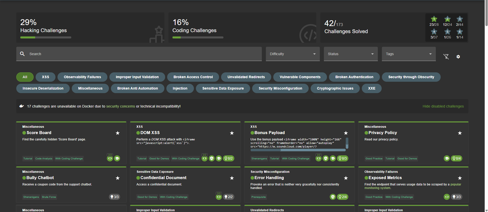
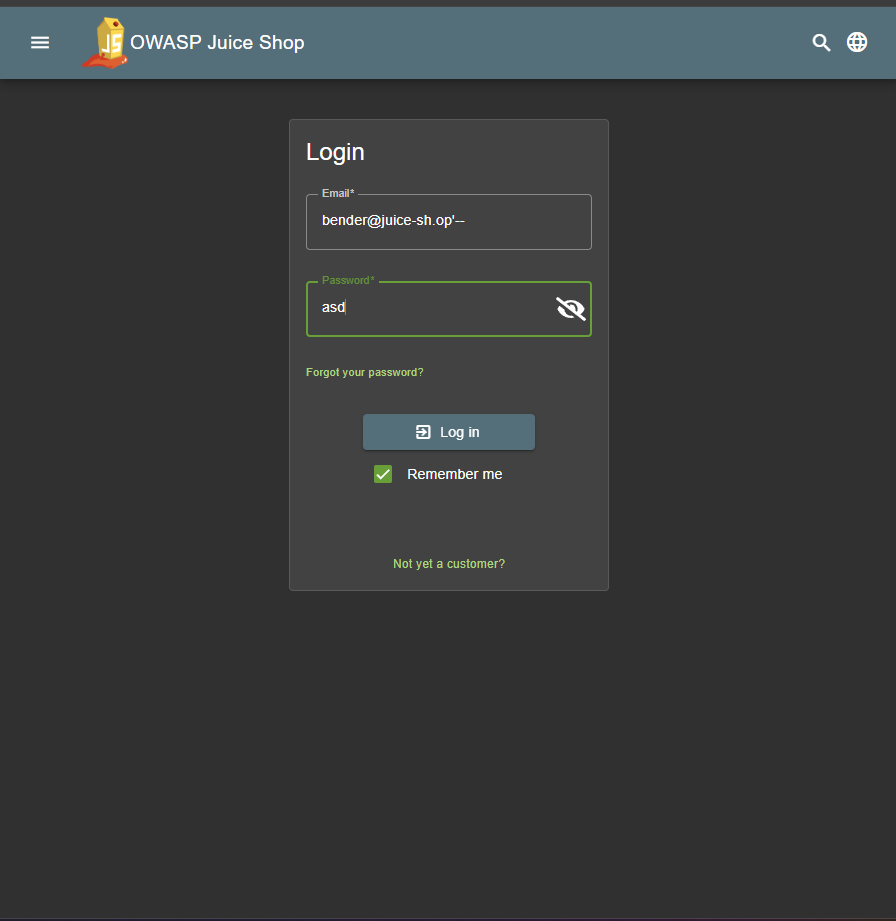
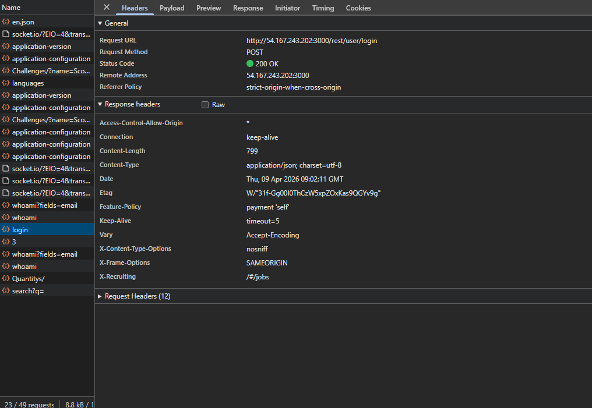
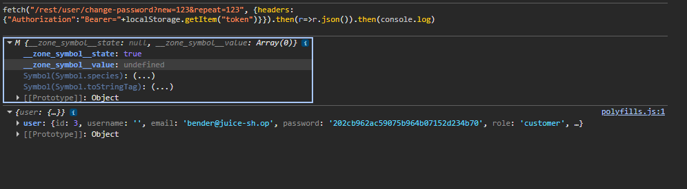
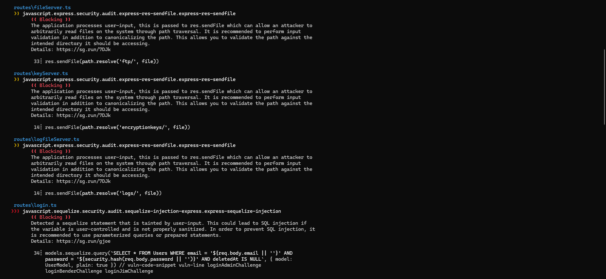

# OWASP Juice Shop – Web Application Security Assessment

A hands-on security assessment of OWASP Juice Shop, a deliberately vulnerable Node.js/Angular web shop. It covers manual exploitation, vulnerability analysis mapped to OWASP Top 10 and CWE, and static analysis (SAST) of the source code with Semgrep.

**Group project (4 students)** · Web Application Security (COMP H2704) · TU Dublin · March–April 2026
**Tools:** Browser DevTools, Semgrep, OWASP ZAP (group DAST), Docker, Python
**Standards:** OWASP Top 10 (2021), CWE, OWASP ASVS, OWASP Proactive Controls



---

## What the project covered

1. **Deploy** Juice Shop and download its source code for analysis
2. **Exploit** at least 20 challenges across difficulty levels
3. **Analyse** 8 vulnerabilities in depth (2 per student): root cause, how they were found, how the exploit works, impact and mitigation
4. **SAST**: scan the source with a static analysis tool, triage the findings and link them to runtime behaviour
5. **DAST**: run a targeted OWASP ZAP scan and manually validate the findings
6. **Live demo** to the lecturer

## My contribution

- **Solved 22 challenges myself**, including 10 of medium or higher difficulty, from 1★ up to **6★ (Forged Coupon)**. The full list is below
- **Wrote 2 of the group's vulnerability analyses:**
  - [SQL Injection in the login form](vulnerability-analyses/01-sql-injection-login.md): CWE-89, OWASP A03:2021
  - [Unverified password change](vulnerability-analyses/02-unverified-password-change.md): CWE-620, OWASP A07:2021
- **Ran the SAST scan and wrote the SAST analysis**: [sast/sast-analysis.md](sast/sast-analysis.md)

The DAST section and the final group report were shared work, so they are not reproduced here.

## Highlights

### 1. SQL injection → log in as any user without a password

`routes/login.ts` builds the SQL query by pasting the email straight into a template string. Entering `bender@juice-sh.op'--` closes the string and comments out the password check, so the server logs you in as Bender.

| Payload | Server response |
|---|---|
|  |  |

**Fix:** parameterised queries or Sequelize model methods instead of raw string queries (OWASP Proactive Control C3, ASVS V5.3.4).

### 2. Change another user's password without knowing the current one

In `routes/changePassword.ts` the check is `if (currentPassword && hash(currentPassword) !== ...)`. If the `current` parameter is left out entirely, the check is skipped. With only a stolen session token, a GET request to `/rest/user/change-password?new=...&repeat=...` changes the password.



**Fix:** always require and verify the current password, use POST with CSRF protection rather than GET, and re-authenticate before sensitive changes (ASVS V2.1.6).

### 3. SAST with Semgrep

I scanned the server-side code (`routes/` and `lib/`, 85 TypeScript files) with the `p/javascript` ruleset. There were **9 findings**: 3 high (2× SQL injection, 1× code injection via `eval`) and 6 medium (4× path traversal through `res.sendFile`, 1× open redirect, 1× hard-coded JWT key). For the top 3, I traced each one from the code to the behaviour of the running app and explained which findings were false positives or lower risk in context.



Raw results are in [`sast/semgrep-routes.json`](sast/semgrep-routes.json) and [`sast/semgrep-lib.json`](sast/semgrep-lib.json). [`sast/parse_semgrep.py`](sast/parse_semgrep.py) is a small script I wrote to summarise them.

## Challenges I solved (22)

| Difficulty | Challenges |
|---|---|
| ★ | Score Board, Bully Chatbot, Confidential Document, Error Handling, Exposed Metrics, Privacy Policy, DOM XSS, Bonus Payload, Missing Encoding, Outdated Allowlist, Zero Stars, Web3 Sandbox |
| ★★ | Login Admin, Password Strength, Deprecated Interface, Empty User Registration |
| ★★★ | Forged Review, Login Bender |
| ★★★★ | Christmas Special, Easter Egg |
| ★★★★★ | Change Bender's Password |
| ★★★★★★ | Forged Coupon |

The categories covered include Injection, XSS, Broken Access Control, Broken Authentication, Sensitive Data Exposure, Security Misconfiguration, Improper Input Validation and Cryptographic Issues.

## What I learned

- Reading the source code (SAST) and attacking the running app (manual testing) answer different questions. The most useful findings were the ones where the two confirmed each other.
- Many serious bugs come down to one small decision: a template string instead of a parameter, or an `&&` that lets a check be skipped.
- Writing a mitigation means explaining *why* it fixes the root cause, not just naming a control.

## Repository structure

```
vulnerability-analyses/   # my two in-depth write-ups
sast/                     # Semgrep methodology, analysis, raw JSON results, parser script
screenshots/              # evidence from the running app and the scans
```

> Juice Shop was attacked only in our own lab deployment for the module. All techniques here are for education on an intentionally vulnerable application.
